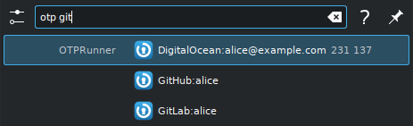
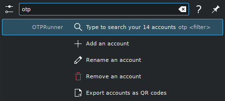
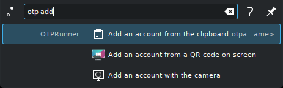
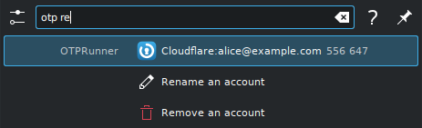
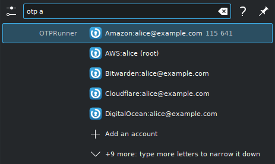
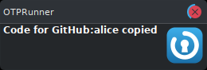
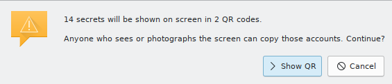

<p align="center">
  
</p>

<h1 align="center">OTPRunner</h1>

<p align="center">
  <b>Your two-factor codes, one keystroke away.</b><br>
  TOTP codes in KRunner, with the secrets kept in your system keystore.
</p>

<p align="center">
  <a href="https://pypi.org/project/otprunner/"></a>
  <a href="https://github.com/baquilla/otprunner/actions/workflows/ci.yml"></a>
  <a href="https://github.com/baquilla/otprunner/blob/main/LICENSE"></a>
</p>

<p align="center">
  
</p>

Press <kbd>Alt</kbd>+<kbd>Space</kbd>, type `otp git`, press <kbd>Enter</kbd>: the code is in
your clipboard. No phone to unlock, no app window to open, and only the line you select
shows its code.

## Why OTPRunner

- **Fast.** Codes live where you already search. Type a few letters and copy.
- **Safe storage.** Secrets go to the keystore your desktop already has: KWallet on KDE, or
  the Secret Service (GNOME Keyring, KeePassXC). Never in plain files.
- **No terminal needed.** Add an account straight from KRunner by selecting the QR code on
  screen, pasting it, or showing it to the webcam.
- **Portable.** Import and export standard `otpauth://` links and Google Authenticator
  transfer codes, including QR codes to move your accounts to your phone.
- **A full CLI too.** Everything the runner does also works from the terminal.

## A quick tour

| | |
|---|---|
|  | **`otp`** on its own shows what you can do. |
|  | **`otp add`** reads a QR code from the screen, the clipboard or the camera. |
|  | **`otp re`** shows the matching accounts, then the commands that start with what you typed. |
|  | Long lists are trimmed so the commands stay visible. Keep typing to narrow down. |
|  | <kbd>Enter</kbd> copies the current code. |
|  | **`otp export`** shows QR codes to scan with your phone, after a warning. |

## Install

```bash
sudo apt install pipx        # Debian/Ubuntu; use your distribution's package otherwise
pipx install otprunner
otprunner install            # registers the KRunner plugin and the user service
otprunner doctor             # checks the keystore, clipboard, screen capture…
```

Then open KRunner and type `otp add`.

It is used daily on Plasma 5.27 with X11. Plasma 6, Wayland and the Secret Service backend
are supported but less tested: reports are welcome.

`otprunner uninstall` removes the plugin; your secrets stay in the keystore.

## Learn more

- [Usage](https://github.com/baquilla/otprunner/blob/main/docs/usage.md): every KRunner command, the CLI, configuration and system tools.
- [Design](https://github.com/baquilla/otprunner/blob/main/docs/design.md): how it works, how accounts are named and stored, security notes.
- [Contributing](https://github.com/baquilla/otprunner/blob/main/CONTRIBUTING.md): development, tests and translations.
- [Changelog](https://github.com/baquilla/otprunner/blob/main/CHANGELOG.md)

The interface is available in English and Spanish; new translations are welcome.

## License

[GPL-3.0-or-later](https://github.com/baquilla/otprunner/blob/main/LICENSE). Forks are
welcome; contributions back to this project even more so.
